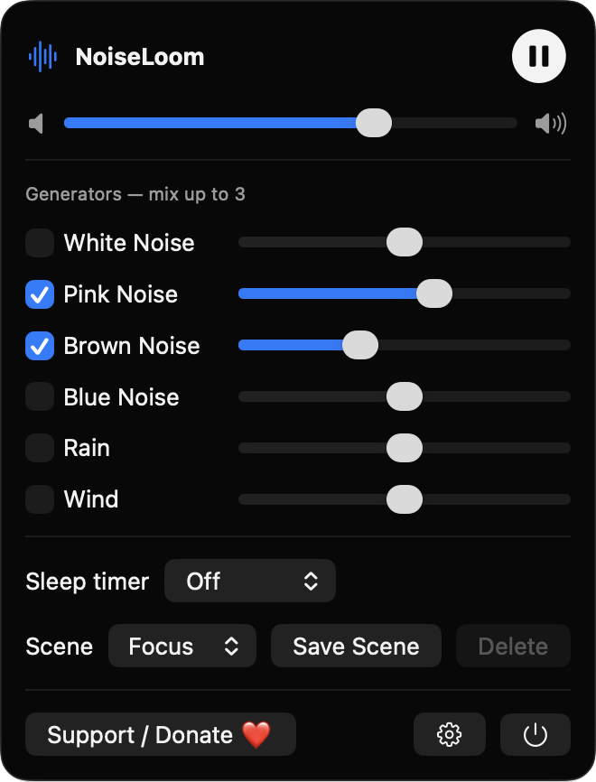
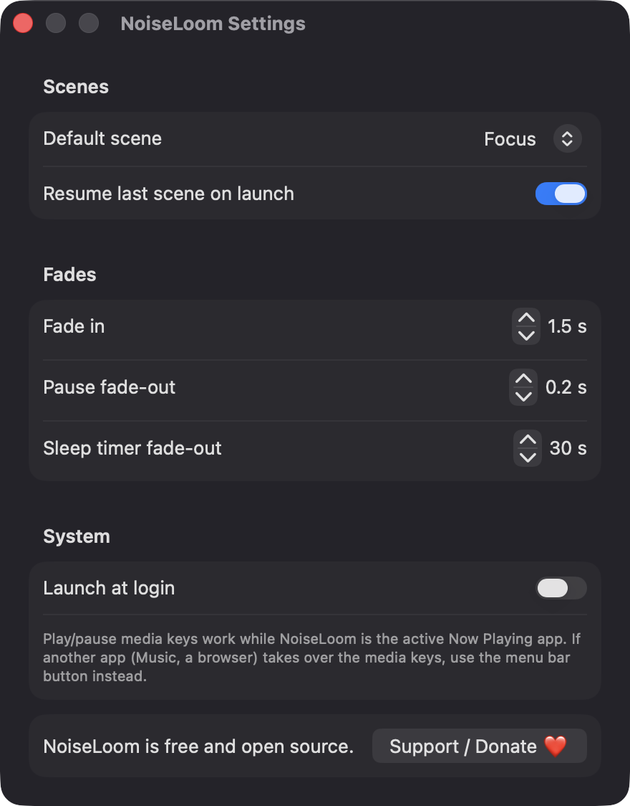

# NoiseLoom

**🌐 Website:** [turhe123.github.io/noise-loom](https://turhe123.github.io/noise-loom/)

Generate white, pink and brown noise plus rain-like textures for focus and sleep, with a timer and menu bar control.


## Why

NoiseLoom is a free, open-source, 100% native, backend-free alternative to paid utilities in the *Audio* category. It was inspired by apps like Dark Noise ($19.99 /year), and aims to cover the essentials of ambient sound for focus and sleep without accounts, subscriptions, network access or bundled sound files. Every sound is synthesized in real time on your Mac.

## Features

- **Six synthesized generators:** white, pink, brown and blue noise, plus a filtered rain-like texture (band-passed pink noise with sparse random bursts) and a wind-like texture (low-passed noise with a slow random modulation).
- **Mix up to three generators at once**, each with its own enable checkbox and volume slider, plus a master volume.
- **Sleep timer** with presets of Off, 15, 30, 60 and 120 minutes. A live countdown is shown, the sound fades out at the end (30 s by default, adjustable) and the panel shows "Stopped by timer". The timer uses an end date, so the countdown stays correct across system sleep.
- **Scenes:** three built-in scenes (Focus, Sleep, Rain), plus save your own named scenes and delete them. Deleting the active scene falls back to the default scene. Scenes are stored locally as JSON in UserDefaults.
- **Menu bar control:** a window-style menu bar panel with a waveform icon that animates subtly while playing.
- **Media keys and Now Playing:** play/pause via the system media keys (through `MPRemoteCommandCenter`) and Now Playing info.
- **Click-free audio:** per-sample gain smoothing, a short pause fade, a configurable fade-in, a gain ceiling on the mix and tanh soft limiting. Render blocks do no allocation or locking.
- **Handles audio route changes** (e.g. unplugging headphones) by restarting the engine.
- **Settings:** default scene, resume last scene on launch, fade-in / pause / sleep-timer fade durations, and launch at login.
- **Built with** SwiftUI, AppKit, AVFoundation, MediaPlayer and ServiceManagement. No third-party packages, no network.

## Screenshots

<p align="center"></p>

<p align="center"><em>The NoiseLoom menu bar panel playing a pink and brown noise mix, with master volume, per-generator sliders, sleep timer and scenes.</em></p>

<p align="center"></p>

<p align="center"><em>Settings for the default scene, resume on launch, fade-in and fade-out durations, and launch at login.</em></p>

## Install

1. Download `NoiseLoom-macOS.zip` from the [latest release](https://github.com/turhe123/noise-loom/releases/latest).
2. Unzip it and move `NoiseLoom.app` to `/Applications`.
3. Because the app is open source and not notarized, remove the quarantine attribute:

   ```bash
   xattr -cr /Applications/NoiseLoom.app
   ```

4. Right-click the app and choose **Open** the first time you launch it.

NoiseLoom lives in the menu bar (look for the waveform icon).

## Build from source

Requires macOS 14+ and Xcode with Swift 5.9+.

```bash
brew install xcodegen
xcodegen generate
xcodebuild -project NoiseLoom.xcodeproj -scheme NoiseLoom -configuration Release -derivedDataPath ./build build
```

The app is produced at `build/Build/Products/Release/NoiseLoom.app`.

## Permissions

NoiseLoom does not request any special permissions. It does not use Accessibility, Screen Recording, Microphone, Camera, location or network access. Audio is only played out, never recorded.

- **Media keys:** handled through the system Now Playing / remote command API, which needs no permission. If another app (Music, a browser) takes over the media keys, use the menu bar button instead.
- **Launch at login:** optional, via `SMAppService`. macOS may show it under System Settings › General › Login Items.

## Support ❤️

NoiseLoom is free and always will be. If it helps you focus or sleep better, you can support development:

[Support Or (Leo) Davidai ❤️](https://ko-fi.com/leodavidai)

## License

MIT © Or Davidai Bachar
